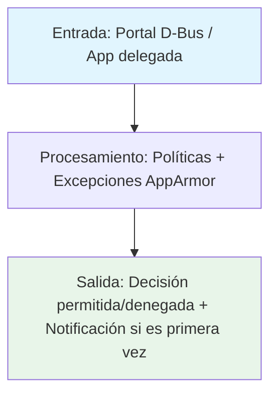
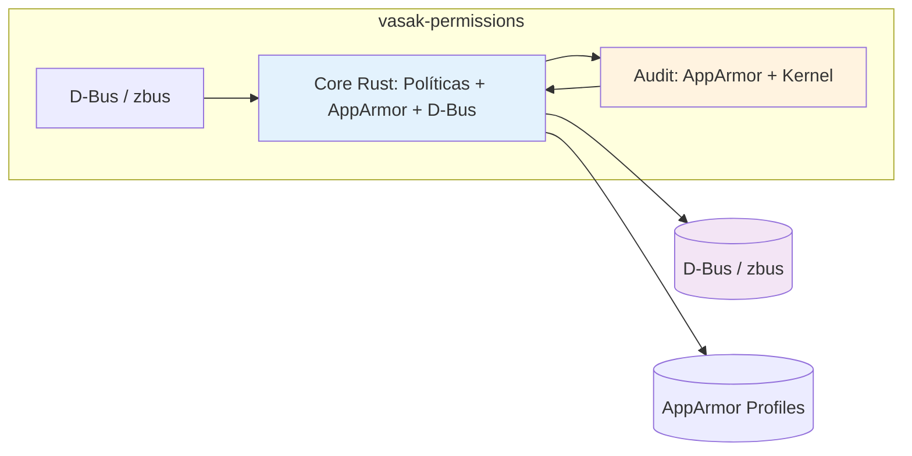
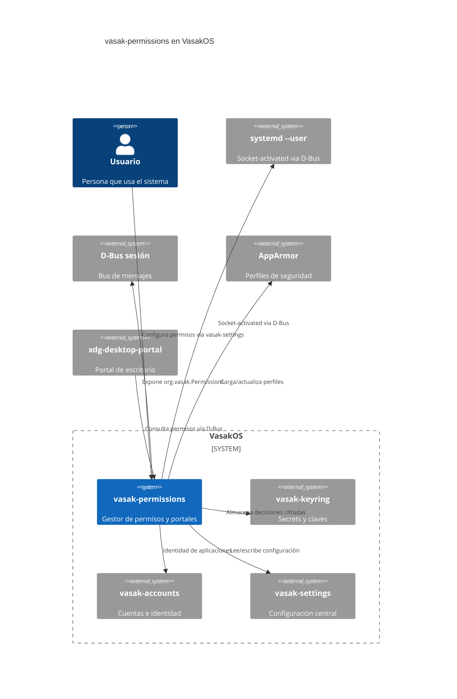

# Vasak permissions

Gestor de permisos y portales de seguridad.

---

## Tecnología

[](https://www.rust-lang.org/) [](https://systemd.io/) [](https://dbus.freedesktop.org/) [](https://github.com/dbus2/zbus)

## Estado

[](https://github.com/Vasak-OS/vasak-permissions/actions/workflows/ci.yml)
[](https://github.com/Vasak-OS/vasak-permissions/releases)
[](LICENSE)
[](https://sonarcloud.io/summary/new_code?id=Vasak-OS_vasak-permissions)
[](https://sonarcloud.io/summary/new_code?id=Vasak-OS_vasak-permissions)
[](https://github.com/Vasak-OS/vasak-permissions)

---

## Descripción

`vasak-permissions` es un servicio de sistema (daemon) que gestiona los permisos y portales de seguridad en VasakOS. Actúa como guardián centralizado que decide qué aplicaciones pueden acceder a recursos sensibles (cámara, micrófono, pantalla, archivos, etc.) basándose en políticas configuradas por el usuario.

**Para el usuario:** Control centralizado de qué aplicaciones pueden acceder a recursos sensibles (cámara, micrófono, pantalla, archivos, etc.) mediante una interfaz de diálogos de consentimiento.

**Integración VasakOS:** Expone la interfaz D-Bus `org.vasak.Permissions` para que el portal de escritorio y las aplicaciones consulten y soliciten permisos. Se integra con `vasak-keyring` para almacenamiento seguro de decisiones y con `vasak-accounts` para identidad de aplicaciones.

---

## Arquitectura

### Flujo de datos



### Componentes internos



### Integración en el sistema VasakOS



---

## Instalación

### Arch Linux (repo oficial)

```bash
pacman -S vasak-permissions
```

### Debian / Ubuntu (.deb)

```bash
wget https://github.com/Vasak-OS/vasak-permissions/releases/download/v{{VERSION}}/vasak-permissions_{{VERSION}}_amd64.deb
sudo apt install ./vasak-permissions_{{VERSION}}_amd64.deb
```

### Desde fuente

```bash
git clone https://github.com/Vasak-OS/vasak-permissions.git
cd vasak-permissions

# Build completo
cargo build --release --locked

# Instalar binario
cargo install --locked --path .
```

### Paquetes nativos

```bash
# Arch: makepkg -sf en PKGBUILDS/vasak-permissions/
# Debian: cargo deb --no-build --target-dir target/release/debian
```

---

## Uso

El servicio se ejecuta automáticamente como servicio systemd --user (socket-activated vía D-Bus). No se lanza manualmente normalmente.

Para debugging:

```bash
cargo run --bin vasak-permissions
```

### D-Bus Interface

El servicio expone la interfaz `org.vasak.Permissions` en el bus de sesión:

| Método | Descripción |
|--------|-------------|
| `CheckPermission(resource_id, detail)` | Verifica/consulta permiso, pregunta al usuario si es primera vez |
| `QueryPermissionFor(pid, start_time, resource_id)` | Consulta decisión guardada sin preguntar (para portal) |
| `SetPermission(binary_path, resource_id, allowed)` | Cambia permiso desde vasak-settings (requiere polkit) |
| `ForgetPermission(binary_path)` | Olvida decisión guardada |
| `ListPermissions` | Lista todas las decisiones guardadas |
| `AllowBlocked(profile, path)` | Permite acceso bloqueado por AppArmor (polkit) |
| `ListBlocked` | Lista bloqueos AppArmor pendientes |
| `ListAllowed(profile)` | Lista reglas AppArmor permitidas |
| `RevokeBlocked(profile, rule)` | Revoca regla AppArmor (polkit) |

---

## Configuración

### Archivo de configuración

```
/etc/vasak/permissions.toml  (sistema)
~/.config/vasak/permissions.toml  (usuario, si aplica)
```

Ejemplo mínimo:

```toml
[general]
log_level = "info"
```

### Variables de entorno

| Variable | Descripción | Por defecto |
|----------|-------------|-------------|
| `VASAK_DEBUG` | Activa logs de depuración en consola | `false` |
| `RUST_LOG` | Nivel de log (trace, debug, info, warn, error) | `info` |

---

## Desarrollo

### Requisitos

- **Rust:** `rustup` toolchain estable (`rust-toolchain.toml` fija la versión)
- **Sistema:** `pkg-config`, `libdbus-1-dev`, `libsystemd-dev`, `libapparmor-dev`, `libsqlcipher-dev`

### Dependencias de desarrollo

#### Sistema (paquetes Arch / Debian / Fedora)

`base-devel`, `pkgconf`, `libdbus-1-dev`, `libsystemd-dev`, `libapparmor-dev`, `libsqlcipher-dev`, `libssl-dev`, `libudev-dev`

#### Rust

`rustup` → `stable` + `rustfmt` + `clippy`

### Correr en desarrollo

```bash
# Backend con recarga en caliente
cargo watch -x "run --bin vasak-permissions"

# Solo tests
cargo test --locked
```

### Compilar / Build de release

```bash
# Build release optimizado
cargo build --release --locked

# Instalar
cargo install --locked --path .

# Paquetes nativos
# Arch: makepkg -sf en PKGBUILDS/vasak-permissions/
# Debian: cargo deb --no-build --target-dir target/release/debian
```

### Targets principales

```bash
# Build release optimizado
cargo build --release --locked

# Tests
cargo test --locked

# Lint
cargo fmt --check
cargo clippy -- -D warnings
```

### Pruebas

```bash
# Suite completa Rust
cargo test --locked

# Tests de integración (requieren D-Bus)
cargo test --locked -- --ignored
```

---

## Arquitectura (texto)

### Crates / módulos principales

| Crate / Módulo | Responsabilidad |
|----------------|-----------------|
| `vasak-permissions` | Binario principal / daemon systemd |
| `vasak-permissions-protocol` | Definiciones D-Bus compartidas |

### Interfaces D-Bus / zbus expuestas

| Interfaz | Métodos / Señales / Propiedades | Descripción |
|----------|----------------------------------|-------------|
| `org.vasak.Permissions` | `CheckPermission`, `QueryPermissionFor`, `SetPermission`, `ForgetPermission`, `ListPermissions`, `AllowBlocked`, `ListBlocked`, `ListAllowed`, `RevokeBlocked`, `RegisterAgent` | Gestión completa de permisos |

### Puntos de extensión

- **Políticas:** Sistema de políticas declarativas por aplicación/recurso
- **Excepciones AppArmor:** Generación dinámica de perfiles
- **Notificaciones:** Integración con `vasak-flare-daemon` para avisos

### Features / Cargo features

| Feature | Descripción | Default |
|---------|-------------|---------|
| `systemd` | Integración systemd (socket activation) | ✓ |
| `tracing` | Logging estructurado con tracing | ✓ |
| `admin` | API administrativa (solo root) | |

---

## Pruebas y calidad

- **Cobertura objetivo:** ≥ 80 % del código nuevo (SonarCloud Quality Gate)
- **Informes:** GitHub Actions → pestaña *SonarCloud Code Analysis* → enlace a SonarCloud
- **Añadir pruebas:** ver `AGENTS.md` sección 9 (mapa de repos y comandos de prueba)
- **Regla:** toda corrección lleva prueba escrita por `qa` que falla sin el fix

---

## Contribuir

- **Guía:** [`.github/CONTRIBUTING.md`](https://github.com/Vasak-OS/.github/blob/main/CONTRIBUTING.md)
- **Plantillas de issue:** [`.github/ISSUE_TEMPLATE/`](https://github.com/Vasak-OS/.github/tree/main/ISSUE_TEMPLATE)
- **Código de conducta:** [`CODE_OF_CONDUCT.md`](https://github.com/Vasak-OS/.github/blob/main/CODE_OF_CONDUCT.md)

---

## Contribuidores

> **Actualizado automáticamente en CI** — muestra los avatares de quienes han aportado código a este repo.

<div align="center">
  <!-- Avatares generados en CI -->
</div>

[Ver todos los contribuidores](https://github.com/Vasak-OS/vasak-permissions/graphs/contributors)

---

## Donadores / Sponsors

[](https://github.com/sponsors/Vasak-OS)

> **Backers:** *Actualizado automáticamente en CI desde GitHub Sponsors / OpenCollective / Polar.*

[💖 Donar al proyecto](https://github.com/sponsors/Vasak-OS)

---

## Licencia

`MIT` — Copyright © 2026 **Vasak-OS Contributors**

[Ver licencia completa](LICENSE)
